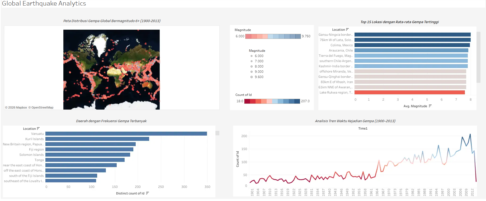

# Global Earthquake Analytics Dashboard for Tableau
An interactive Tableau dashboard exploring more than a century of large earthquakes worldwide. It covers 8,313 earthquakes of magnitude 6.0 and above, recorded between January 1900 and March 2014, and shows when they happened, where they cluster, and which regions have produced the strongest events.

# How To Use
To view the dashboard, download earthquake-analytics.twbx file from /dashboards folder and open it using Tableau Public or Tableau Desktop.

# Viewing via Tableau Public
https://public.tableau.com/app/profile/nuzulia.adistianingrum/viz/TugasDataAnalytic_17753979371940/GlobalEarthquakeAnalytics
